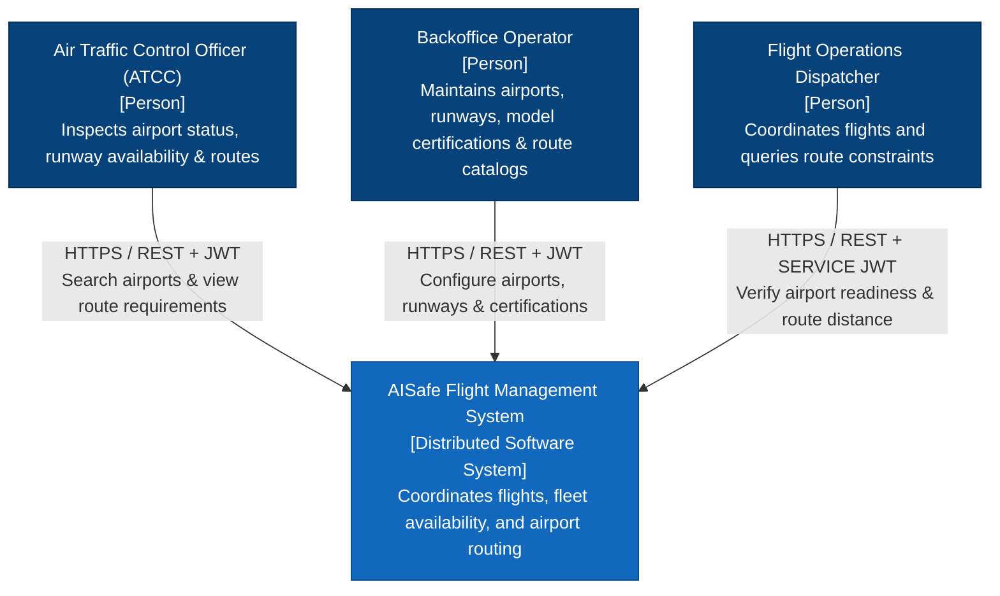
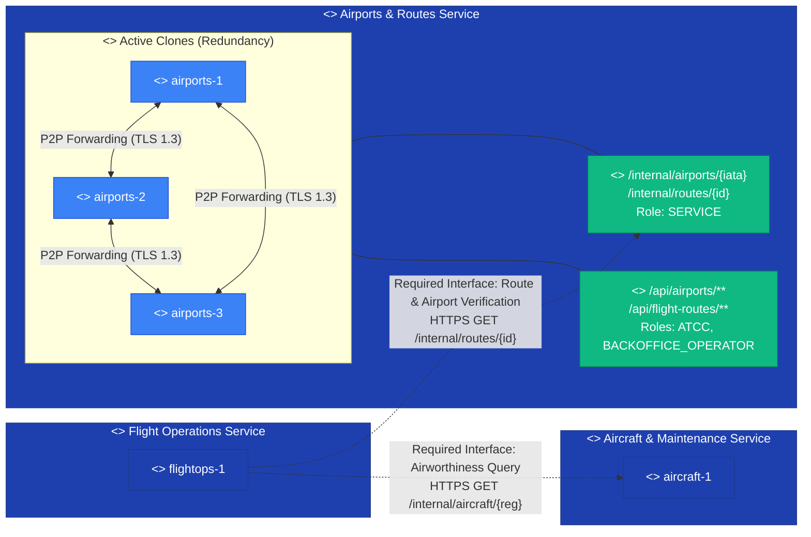
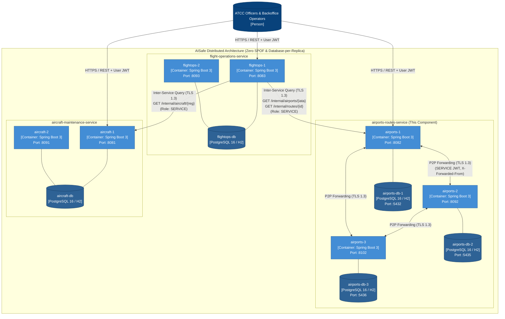
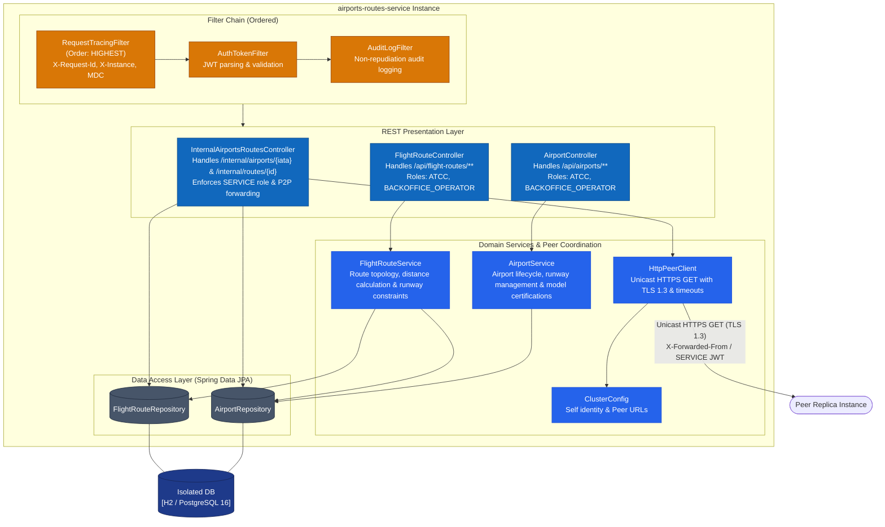
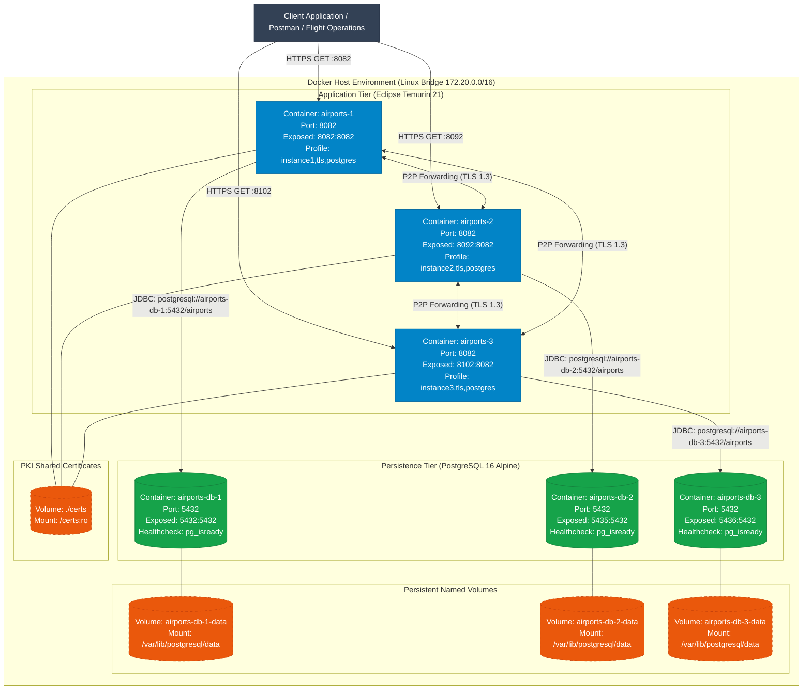
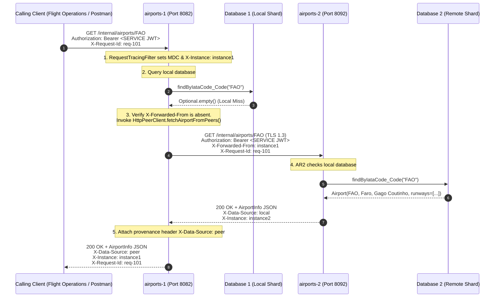
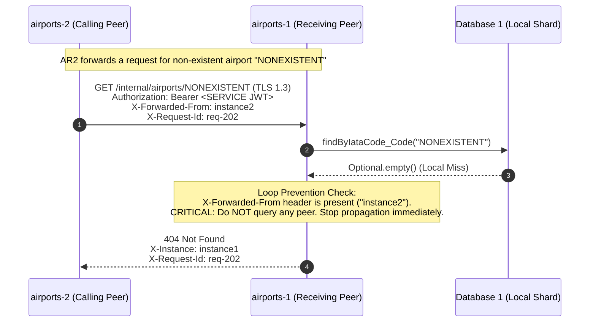
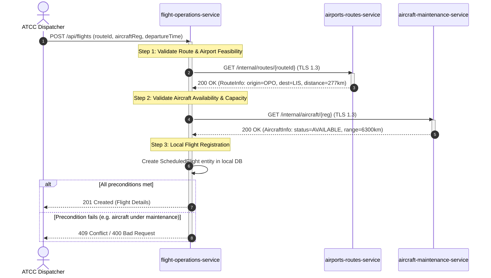

# AISafe Flight Management System - C4+1 Architectural Model
**Component**: `airports-routes-service`  
**Course**: Sistemas Distribuídos (LETI-SIDIS 2026/27) – ISEP  
**Author**: Afonso Sobreiro (1241013)  

**Contents:** [Level 1: Context](#level-1-system-context-diagram) · [UML Logical View](#uml-logical-view-level-1-deployment-independent-component-model) · [Level 2: Containers](#level-2-container-diagram-domain-driven-segregation) · [Level 3: Components](#level-3-component-diagram-inside-airports-routes-service) · [Deployment View](#level-4-deployment-view-multi-instance-docker-deployment) · [Dynamic Scenarios (+1)](#the-1-dynamic-distributed-behavior-sequence-diagrams)

---

## 1. Introduction & Notation

This document formalizes the architectural design of the **Airports & Routes Service** using the **C4 model** (Context, Containers, Components, Code) originated by Simon Brown, combined with the dynamic "+1" scenarios of Philippe Kruchten's **4+1 View Model** (IEEE Software, 1995).

---

## Level 1: System Context Diagram

Visualizes the high-level boundaries of the AISafe distributed system, human actors, and the operational responsibilities of the airports and flight navigation routing division.

---

## UML Logical View Level 1 (Deployment-Independent Component Model)

Following the formal specification in *Testing Component Collaboration, Cloning, UML Logical View Level 1* (Prof. Orlando Sousa, Week 4 Practical Session, Slides 14–15):

* **Components (`<<component>>`):** Captures high-level service boundaries and functional autonomy regardless of physical deployment.
* **Instances (`<<instance>>`):** Visualizes redundancy and active cloning (`airports-1`, `airports-2`, `airports-3`) to eliminate single points of failure.
* **Interfaces & Endpoints:** Explicitly represents provided interfaces (Lollipop / REST endpoints) and required interfaces (Socket / REST client dependencies).
* **Dependencies:** Directed dependencies illustrating inter-service collaboration and unicast peer forwarding.

---

## Level 2: Container Diagram (Domain-Driven Segregation)

Illustrates the decomposition of the original PSOFT monolith into three autonomous, domain-aligned microservices, highlighting active component cloning, isolated databases, and TLS 1.3 encryption in transit.

---

## Level 3: Component Diagram (Inside an `airports-routes-service` Instance)

Details the internal components of an instance, including the security and distributed tracing filter chain, REST presentation controllers, domain business logic, P2P peer client, and data persistence repositories.

---

## Level 4: Deployment Diagram (Physical & Virtual Container Topology)

Details the physical/virtual deployment architecture within Docker, illustrating listening ports, network aliases, dedicated storage volumes, and TLS certificates.

---

## The "+1": Dynamic Distributed Behavior (Sequence Diagrams)

### Scenario 1: P2P Unicast Query Forwarding Across Replicas
Demonstrates how Instance 1 satisfies a query for partition `FAO` (residing natively on Instance 2) while attaching correlation and provenance headers over TLS 1.3.

---

### Scenario 2: Distributed Loop Prevention (Cutting Cycle Storms)
Proves that recursive or circular forwarding requests are terminated at the first hop ($hop \le 1$).

---

### Scenario 3: Inter-Service Flight Booking Saga with Compensating Actions
Illustrates the synchronous command sequence executed by Flight Operations to verify and book a flight, interacting with `airports-routes-service` and `aircraft-maintenance-service`.

