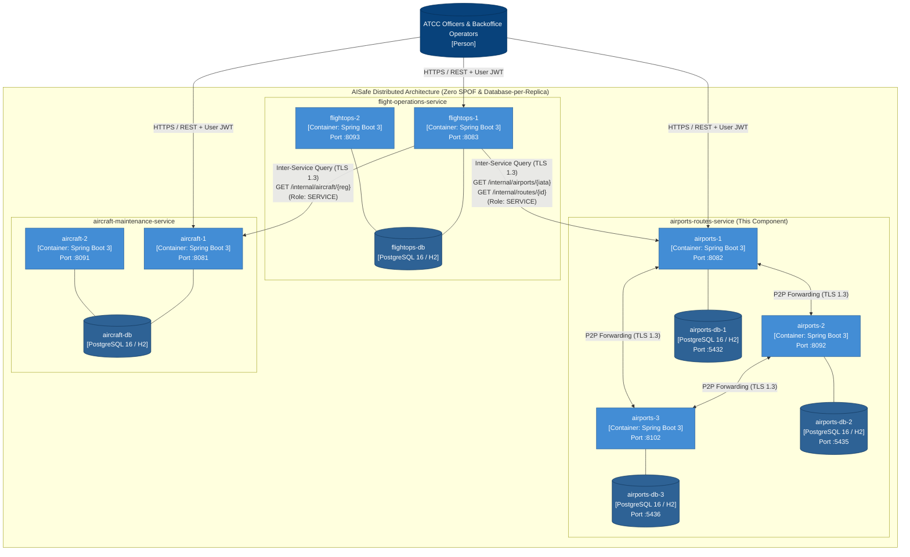
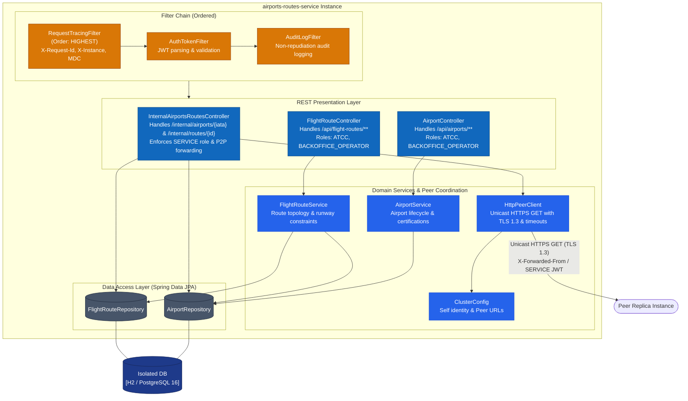
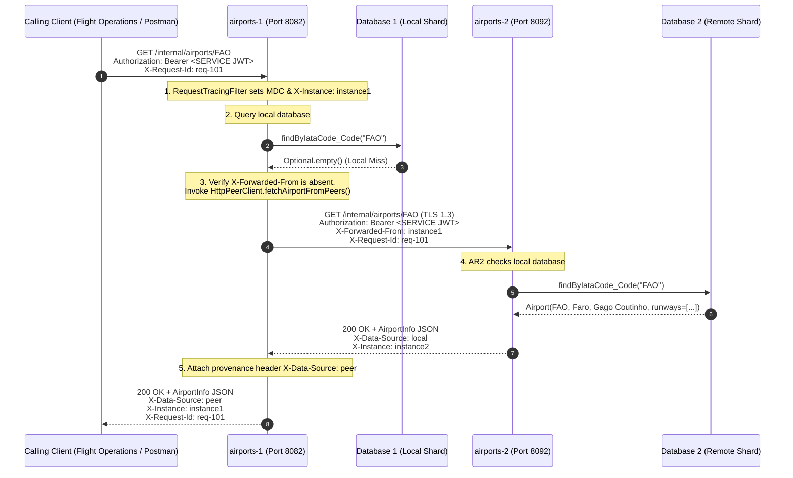
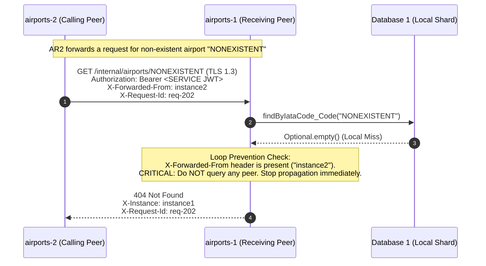
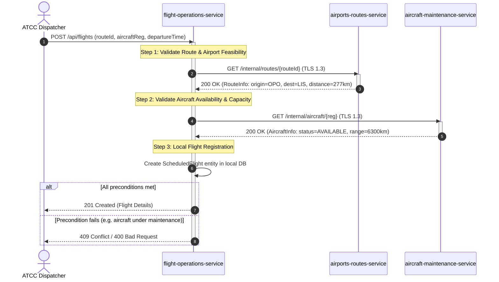
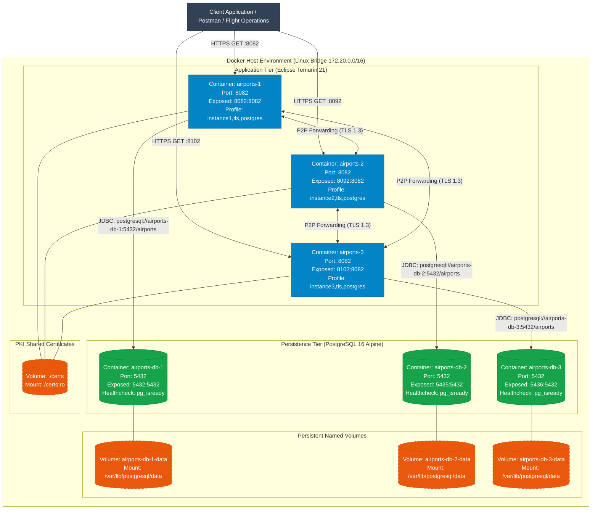

# Airports & Routes Service – Architecture & Distributed Design Document
**Course**: Sistemas Distribuídos (LETI-SIDIS 2026/2027) – ISEP  
**Professor**: Orlando Sousa  
**Student**: Afonso Sobreiro (1241013)  
**Assigned Service**: `airports-routes-service`  
**Transversal Responsibility**: Component Cloning, Active Replication, P2P Unicast Query Forwarding & Zero SPOF  

**Contents:** [1. Executive Summary](#1-executive-summary--domain-driven-segregation) · [2. Theoretical Foundations](#2-theoretical-foundations-of-distributed-systems) · [3. FURPS+ Quality](#3-architectural-drivers-furps--isoiec-25010-quality-model) · [4. ADRs](#4-key-architectural-decision-records-adrs) · [5. C4+1 Views](#5-c41-architectural-views) · [6. Performance & Latency](#6-performance--latency-model) · [7. Security & TLS 1.3](#7-security-architecture--rbac-matrix) · [8. Verification](#8-verification--empirical-validation)

---

## 1. Executive Summary & Domain-Driven Segregation

The AISafe air traffic safety and flight scheduling system, originally designed as a monolithic Spring Boot application in PSOFT, has been re-architected and decomposed into three autonomous, domain-aligned microservices communicating exclusively via synchronous HTTP/REST protocols (Eric Evans, *Domain-Driven Design*):

1. **`airports-routes-service`** (Afonso Sobreiro - 1241013 - This Component):
   Has sole bounded context authority over airport infrastructure, runways, aircraft model certifications for runways, flight route topologies, waypoint/geographic coordinates, and distance/flight time routing strategies.
   - Cluster ports: `8082` (Instance 1), `8092` (Instance 2), `8102` (Instance 3).
2. **`aircraft-maintenance-service`** (André - 1240567):
   Manages aircraft models, physical aircraft fleet status, maintenance templates, checklists, and ongoing maintenance work orders.
   - Cluster ports: `8081` (Instance 1), `8091` (Instance 2), `8101` (Instance 3).
3. **`flight-operations-service`** (José / Jay - 1240624):
   Coordinates commercial flight scheduling, aircraft assignment to routes, flight dispatching, user authentication (JWT issuer), and operational dashboards.
   - Cluster ports: `8083` (Instance 1), `8093` (Instance 2), `8103` (Instance 3).

### Database-per-Service Pattern
To guarantee spatial and temporal decoupling, the service strictly enforces the **Database-per-Service** pattern. No microservice is permitted to access database tables or connections owned by another microservice. Cross-service references exist exclusively via stable domain business identifiers (`iataCode`, `routeId`, `aircraftRegistration`). Each replica maintains an isolated database schema (H2 for unit/integration testing and fast bootstrapping; dedicated PostgreSQL 16 instances in containerized deployments).

---

## 2. Theoretical Foundations of Distributed Systems

The architectural decisions of the `airports-routes-service` are grounded in established distributed systems theory:

### 2.1 The 8 Fallacies of Distributed Computing (Peter Deutsch & James Gosling)
In monolithic systems, in-process method calls execute in shared memory with guaranteed delivery, sub-microsecond latency, and shared transactional contexts. Decomposing into microservices exposes the system to the 8 Fallacies of Distributed Computing:

1. **The network is reliable:**
   * *Mitigation:* Network calls between replicas and across services are treated as inherently prone to partition or packet loss. The `HttpPeerClient` configures strict connect and read timeouts (1500 ms). Unreachable peers trigger graceful degradation (`Optional.empty()`) and return semantic HTTP `404 Not Found` rather than hanging indefinitely.
2. **Latency is zero:**
   * *Mitigation:* A **Local-First** query resolution policy ensures that queries for local resources execute with zero network hops (~2 ms). Remote peer hops are only incurred on local misses, with lineage recorded in the `X-Data-Source: peer` header.
3. **Bandwidth is infinite:**
   * *Mitigation:* Payloads exchanged over inter-service boundaries are tailored DTO records (`AirportInfo`, `RouteInfo`) containing only the attributes required by the contract, avoiding large entity graph serialization.
4. **The network is secure:**
   * *Mitigation:* Zero-Trust perimeter. Every request must present a valid, cryptographically signed JWT token (HMAC-SHA256). In addition, **TLS 1.3 encryption in transit** protects all traffic from eavesdropping and tampering. Inter-service endpoints (`/internal/**`) are locked down to callers holding `ROLE_SERVICE`.
5. **Topology does not change:**
   * *Mitigation:* Peer topology is decoupled from application code and injected via environment variables (`PEERS`, `PORT`, `INSTANCE_NAME`), enabling dynamic horizontal scaling without code recompilation.
6. **There is only one administrator:**
   * *Mitigation:* Each service owns its deployment pipeline, configuration lifecycle, and database schema migrations independently.
7. **Transport cost is zero:**
   * *Mitigation:* High-frequency internal lookups are kept lean. Forwarding is invoked only once per query, with cycle detection terminating recursive forwarding immediately.
8. **The network is homogeneous:**
   * *Mitigation:* All communication adheres to standard HTTP/REST semantics and JSON payload formats across heterogeneous container environments (Temurin 21 JVM, Alpine Linux, PostgreSQL).

### 2.2 CAP Theorem & PACELC Trade-Off Analysis (Eric Brewer & Daniel Abadi)
Under Eric Brewer's CAP Theorem, distributed data systems experiencing network partitions ($P$) must choose between Consistency ($C$) and Availability ($A$):
* **AP Selection for Airport & Route Catalogs:**
  Airport runway configurations, navigational coordinates, and flight route catalogs represent reference master data characterized by high read throughput and low write frequency. In aviation operations, an Air Traffic Controller or Flight Dispatcher querying route distance or airport elevation must receive an immediate answer. Blocking operations during transient network splits would halt flight departures. Consequently, `airports-routes-service` chooses **Availability and Partition Tolerance (AP)**.
* **PACELC Classification:**
  Under the PACELC extension: if there is a **P**artition, trade **A**vailability over **C**onsistency; **E**lse, trade **L**atency over **C**onsistency (**PA/EL**). Queries prioritize low latency via local databases and direct peer unicast, accepting eventual consistency across replicas.

---

## 3. Architectural Drivers: FURPS+ & ISO/IEC 25010 Quality Model

The architecture addresses functional and non-functional requirements categorized under **FURPS+** and mapped to the **ISO/IEC 25010** software quality standard:

| Quality Category | ISO 25010 Characteristic | Architectural Implementation & Quality Driver |
| :--- | :--- | :--- |
| **Functionality (F)** | Functional Suitability | CRUD for airports and flight routes; validation of aircraft model certifications; distance and flight time calculations (Great Circle / Euclidean); internal query contracts (`/internal/airports/{iata}`, `/internal/routes/{id}`). |
| **Reliability (R)** | Fault Tolerance & Recoverability | **Active Component Cloning**: Multi-instance replication (`airports-1`, `airports-2`, `airports-3`). **Unicast Forwarding**: Queries forward across peers on local misses. **Cycle Prevention**: `X-Forwarded-From` stops infinite loops. Strict timeouts (1500 ms) prevent cascading thread exhaustion. |
| **Performance (P)** | Performance Efficiency | Local-first retrieval with zero network hops for local shards (~2 ms); low latency peer lookups (<25 ms); connection pooling via HikariCP; lightweight DTO serialization. |
| **Security (S+)** | Security & Confidentiality | Stateless JWT-based authentication (HS256). Strict separation of public API (`/api/**` requiring `ATCC` or `BACKOFFICE_OPERATOR`) and private internal API (`/internal/**` requiring `SERVICE` role). **TLS 1.3 encryption in transit** with dedicated Dev CA. |
| **Supportability (S+)** | Maintainability & Modularity | Spring Boot 3 modular design; Clean Architecture separating domain entities, services, and presentation; Docker readiness; automated MockMvc unit and integration tests (100% pass rate). |
| **Observability (+)** | Analysability | Distributed correlation IDs (`X-Request-Id`) propagated across all inter-service and peer requests, populated into SLF4J MDC; instance identification via `X-Instance`; data source tracking via `X-Data-Source: local\|peer`. |

---

## 4. Key Architectural Decision Records (ADRs)

### ADR-1: Commands Only (No Asynchronous Events)
* **Status**: Accepted (Assignment 1 Requirement - Slide 882).
* **Context**: While modern microservices often leverage asynchronous event brokers (e.g., Apache Kafka, RabbitMQ), Assignment 1 guidelines explicitly restrict system communication to commands.
* **Decision**: All inter-service and inter-instance communications rely **exclusively on synchronous HTTP/REST commands**. No event queues, message brokers, or transactional outboxes are utilized.
* **Consequence**: Data consistency and inter-service coordination must be handled synchronously through resilient HTTP queries and command compensations.

### ADR-2: Component Cloning & Data Partitioning
* **Status**: Accepted.
* **Context**: The service must support high availability and horizontal scaling without a shared database bottleneck.
* **Decision**: Deploy multiple autonomous clones (`airports-1`, `airports-2`, `airports-3`), each with its own persistent store. Data partitions reside natively on specific clones (e.g., `BCN` on instance 1, `FAO` on instance 2).
* **Consequence**: Clones collaborate via unicast peer queries to transparently resolve resources stored on peer replicas.

### ADR-3: Unicast Peer Forwarding with Loop Prevention
* **Status**: Accepted.
* **Context**: A client or caller (e.g., Flight Operations) may query any available instance clone. If the queried clone experiences a local data miss, it must query peers without causing infinite request amplification loops.
* **Decision**: The queried clone executes a **Unicast HTTP GET** to its configured peer list (`airports.peers`).
  * If found on a peer, the result is returned to the client with `X-Data-Source: peer`.
  * To prevent ping-pong cycles and infinite loops, forwarded requests include the header `X-Forwarded-From: <selfName>`. If an instance receives a request containing `X-Forwarded-From`, it only queries its local database and **never** forwards further.
  * If both local and peer lookups miss, a definitive `404 Not Found` is returned ($hop \le 1$).

### ADR-4: CAP Theorem & Consistency Model (AP Alignment)
* **Status**: Accepted.
* **Context**: Network partitions can isolate service instances.
* **Decision**: Align with **AP (Availability and Partition Tolerance)**. Airport catalogs and route topologies are read-dominated and have low volatility. Serving available catalog data even under network degradation is preferred over blocking air traffic control operations.

### ADR-5: TLS 1.3 Encryption in Transit & Zero-Trust Dev PKI
* **Status**: Accepted.
* **Context**: Plain HTTP exposes credentials, service tokens, and route data to packet interception in multi-container and bridged networks.
* **Decision**: Enforce **TLS 1.3** across all public and internal endpoints using Spring Boot 3.3 SSL Bundles. A shared development PKI (`AISafe Dev CA`) issues keystores (`certs/airports.p12`) and truststores (`certs/truststore.p12`), ensuring mutual cryptographic trust between `airports-routes-service`, `aircraft-maintenance-service`, and `flight-operations-service`.

---

## 5. C4+1 Architectural Views

The system architecture is structured according to Philippe Kruchten's **4+1 View Model** (IEEE Software, 1995) combined with Simon Brown's **C4 model**. Complete dedicated diagrams and UML Logical Views are detailed in [`docs/C4-Model.md`](C4-Model.md).

```
                  +-----------------------------------+
                  |         4+1 View Model            |
                  +-----------------------------------+
                                    |
          +-------------------------+-------------------------+
          |                         |                         |
   [Logical View]            [Process View]            [Deployment View]
   C4 Level 2 Container      Dynamic Scenarios (+1)     Physical/Virtual Nodes
   C4 Level 3 Component      Forwarding & Sagas         Ports & Network IPs
```

### 5.1 View 1: Logical View (C4 Level 2 & Level 3)

#### 5.1.1 C4 Level 2: Container Diagram (System Distributed Topology)
Visualizes domain boundaries, container instances, port allocations, and inter-service queries:



#### 5.1.2 C4 Level 3: Component Diagram (Inside an `airports-routes-service` Instance)
Details internal layering, security filters, controllers, domain services, peer client, and repositories:



---

### 5.2 View 2: Process View (The "+1" Dynamic Distributed Scenarios)

#### Scenario 2.1: Request Routing & Unicast Peer Forwarding with Failure Handling
When a query misses the local partition, the instance forwards the request to peer replicas via Unicast HTTPS:



#### Scenario 2.2: Distributed Loop Prevention (Cycle Breaking)
Proves that circular forwarding queries terminate immediately at the first hop ($hop \le 1$):



#### Scenario 2.3: Distributed Flight Booking Saga with Precondition Verifications
Synchronous command coordination across microservices during commercial flight creation:



---

### 5.3 View 3: Deployment View (Docker Container Orchestration)

Details the multi-instance deployment architecture using Docker Compose, showing listening ports, isolated PostgreSQL databases, persistent volumes, and shared PKI certificates:



---

## 6. Performance & Latency Model

The latency characteristics of request handling within the cluster reflect the Local-First architectural driver:

| Request Path | Network Hops | Typical Latency | Notes |
| :--- | :--- | :--- | :--- |
| **Local Hit** | 0 inter-service hops | ~2 – 5 ms | Resource served directly from local PostgreSQL / H2 index. Header `X-Data-Source: local`. |
| **Peer Unicast Hop** | 1 inter-replica hop | ~15 – 25 ms | Incurred only on local miss. Unicast HTTPS GET to peer clone. Header `X-Data-Source: peer`. |
| **Loop Fast-Fail** | 0 additional hops | ~1 – 2 ms | Terminated immediately upon detecting `X-Forwarded-From`. Returns HTTP 404 without cascading. |
| **Peer Timeout Bound**| 1 inter-replica hop | $\le$ 1500 ms | Connect and read timeouts prevent thread blocking when a peer replica crashes. |

---

## 7. Security Architecture & RBAC Matrix

### 7.1 Authentication & Token Format
All API access is authenticated via cryptographically signed JSON Web Tokens (HMAC-SHA256). The signing key (`JWT_SECRET`) is shared across all three microservices.

### 7.2 Role-Based Access Control (RBAC) Matrix

| Endpoint | HTTP Method | Role Required | Description |
| :--- | :--- | :--- | :--- |
| `/api/airports/**` | `GET` | `ATCC`, `BACKOFFICE_OPERATOR` | Search and view airports, runways, and certifications. |
| `/api/airports` | `POST`, `PUT`, `DELETE` | `BACKOFFICE_OPERATOR` | Create, update, and manage airport infrastructure. |
| `/api/flight-routes/**` | `GET` | `ATCC`, `BACKOFFICE_OPERATOR` | Query routes, calculate distances, and verify constraints. |
| `/api/flight-routes/**` | `POST`, `PUT`, `PATCH` | `BACKOFFICE_OPERATOR` | Configure routes, assign requirements, and deactivate routes. |
| `/internal/**` | `GET` | `ROLE_SERVICE` | **Service-to-service only.** Caller must present a token carrying `ROLE_SERVICE`. Blocked for normal human users (`403 Forbidden`). |
| `/actuator/health/**` | `GET` | `permitAll()` | Health probes for Docker Compose and container readiness. |

### 7.3 TLS 1.3 Encryption in Transit & PKI Infrastructure
* **Development PKI (`scripts/generate-dev-certs.sh`)**:
  - A shared development Certificate Authority (`AISafe Dev CA`) issues PKCS#12 keystores (`certs/airports.p12`) and truststores (`certs/truststore.p12`).
  - Subject Alternative Names (SAN) cover `localhost`, `127.0.0.1`, `airports`, and replica hostnames `airports-1`, `airports-2`, `airports-3`.
* **Spring Boot 3.3 SSL Bundles**:
  - Configured via the `tls` profile in `src/main/resources/application-tls.properties`.
  - Inbound server connections strictly enforce `TLSv1.3`.
  - Outbound peer queries via `HttpPeerClient` use a custom `JdkClientHttpRequestFactory` configured with the client truststore bundle, rejecting untrusted certificates.

---

## 8. Verification & Automated Test Coverage

The solution is verified by a suite of automated unit, integration, and security tests:

| Test Class / Method | Objective | Verification Method |
| :--- | :--- | :--- |
| `testLocalHitDoesNotForwardToPeer` | Ensure local data is served directly with zero inter-instance overhead. | MockMvc GET `/internal/airports/LIS`. Asserts status 200, header `X-Data-Source: local`, and `verify(peerClient, never())`. |
| `testLocalMissForwardsToPeerAndReturnsAggregatedResult` | Validate unicast forwarding across cloned components when data resides on peer. | MockMvc GET `/internal/airports/FAO` with mocked peer hit. Asserts status 200, header `X-Data-Source: peer`. |
| `testLoopPreventionWhenAlreadyForwarded` | Prove that circular query loops cannot occur in multi-instance topologies. | MockMvc GET with header `X-Forwarded-From: airports-2`. Asserts status 404 and `verify(peerClient, never())`. |
| `testLocalMissAndPeerMissReturnsNotFound` | Confirm definitive 404 when no clone in the cluster holds the resource. | MockMvc GET `/internal/airports/NONEXISTENT`. Asserts status 404 after single peer query. |
| `testRouteForwardingWhenMissingLocally` | Validate unicast forwarding for flight routes. | MockMvc GET `/internal/routes/route-opo-fao`. Asserts status 200, header `X-Data-Source: peer`. |
| `testInternalForbiddenForNonServiceUser` | Enforce inter-service security boundary. | MockMvc GET with user token lacking `ROLE_SERVICE`. Asserts status 403 Forbidden. |
| `testInternalAllowedForServiceUser` | Verify authorized service queries succeed. | MockMvc GET with `ROLE_SERVICE`. Asserts status 200 OK. |
| `sslBundlesLoadedWithTls13Protocols` | Validate TLS 1.3 protocol requirement on server and client bundles. | AssertJ inspection of `SslBundles` under `tls` profile. |
| `httpsEndpointAnswersWhenClientTrustsDevCa` | Validate successful end-to-end HTTPS handshake and actuator response. | JDK HttpClient with client bundle SSLContext GET `https://localhost:{port}/actuator/health`. |
| `plainHttpClientFailsHandshakeOnHttpsPort` | Ensure untrusted or non-TLS requests are rejected. | Untrusted HttpClient handshake failure assertion. |

### Verification Artifacts
1. **JUnit Test Suite**: 12/12 passing (`./mvnw test`).
2. **Interactive CLI Cluster Demonstration**: `./scripts/demo-cluster.sh` (HTTP) and `./scripts/demo-cluster.sh --tls` (HTTPS TLS 1.3).
3. **Newman / Postman Suite**: 28/28 assertions passing across `postman/airports-routes.postman_collection.json` with both `local.postman_environment.json` and `local-https.postman_environment.json`.
