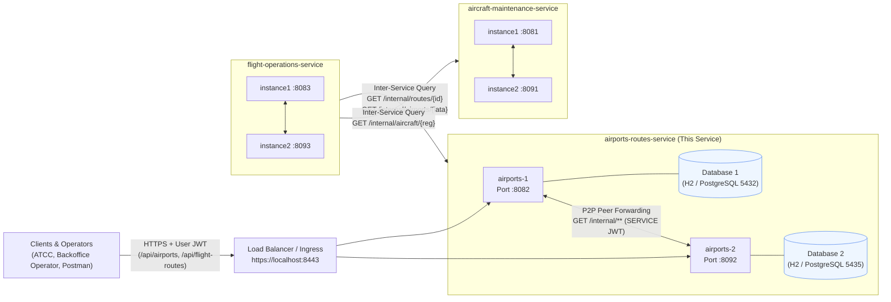
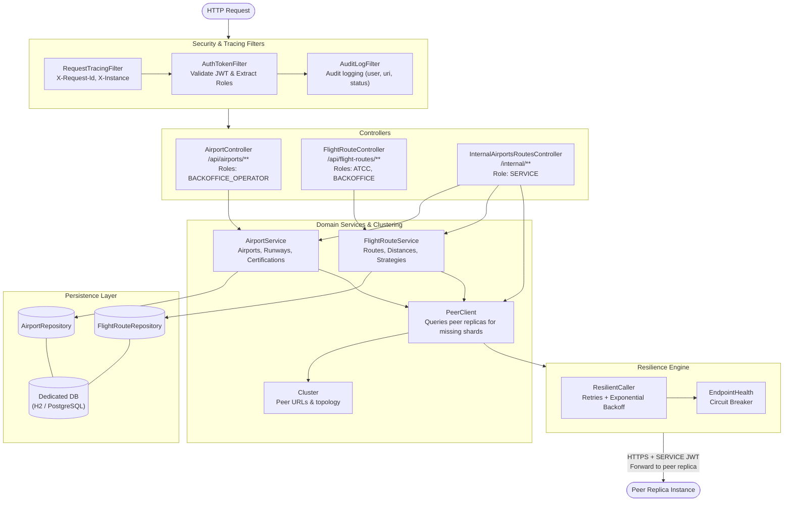
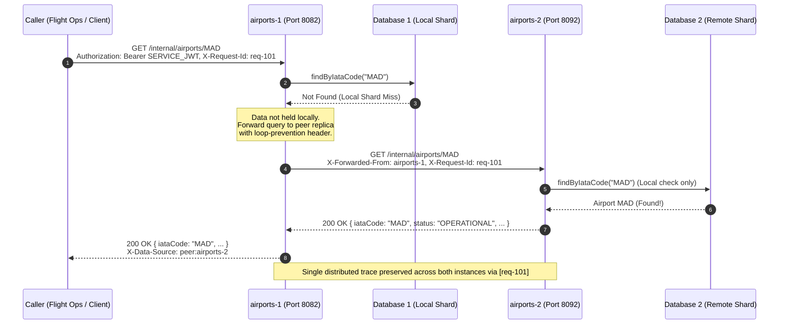
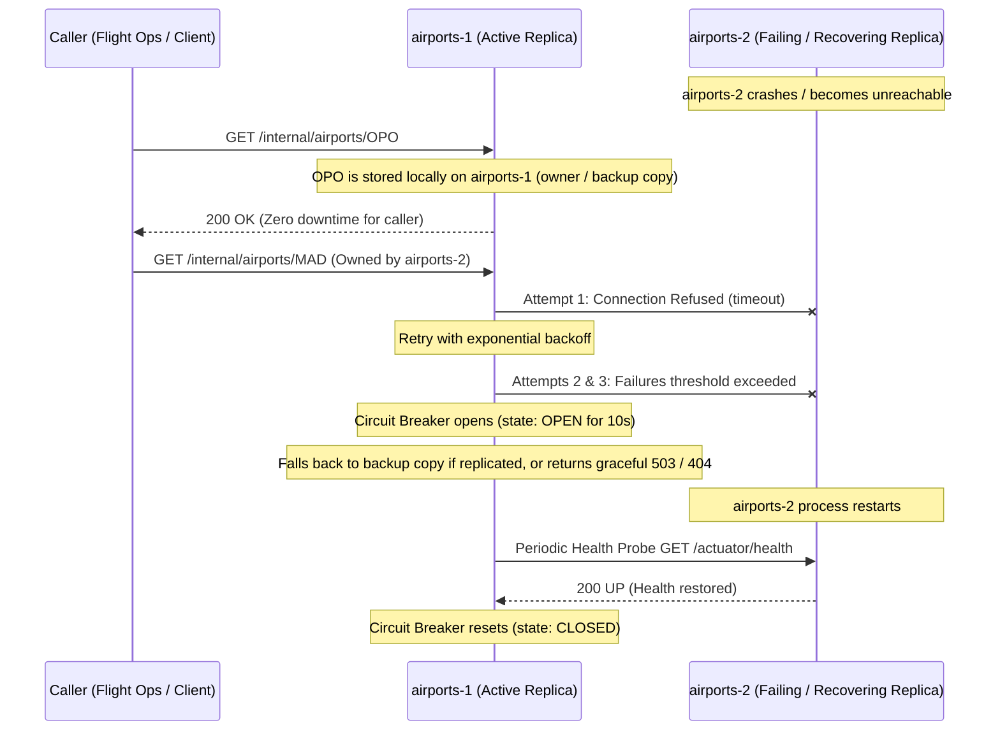

# Airports & Routes Service – Architecture & Distributed Design

This document details the architectural decisions, C4 model representations, consistency model, and fault-tolerance mechanisms for the **Airports & Routes service** in the distributed AISafe system (SIDIS 2026/2027).

---

## 1. C4 Architecture Diagrams

### 1.1. Level 2: Container Diagram (Distributed System Overview)

The system is decomposed into 3 independent microservices communicating over HTTPS/REST with stateless JWT authentication. Each service runs in multiple replicas with its own dedicated database.

---

### 1.2. Level 3: Component Diagram (Inside an `airports-routes-service` Instance)

---

## 2. Dynamic Interactions & P2P Replication

### 2.1. Peer-to-Peer Query Forwarding (Local Miss $\rightarrow$ Peer Forward)

When an incoming request reaches an instance that does not store the requested entity locally due to data partitioning:
1. The instance checks its local database.
2. On a local miss, it checks if the request was already forwarded. If not, it forwards the query to its peer replica via HTTP/REST using a `SERVICE` token and attaches `X-Forwarded-From: <instance-id>` to prevent recursion loops.
3. The peer replica looks up the record locally and returns it.
4. The initial instance returns the response to the caller with header `X-Data-Source: peer:<peer-id>`.
5. Only if **no** replica holds the resource is a `404 Not Found` returned, ensuring callers (such as Flight Operations) can rely on a 404 as final.

---

### 2.2. Failure & Automatic Recovery

---

## 3. Consistency Model & CAP Theorem Justification

* **AP Alignment (Availability & Partition Tolerance)**:
  In accordance with the assignment guidelines, the system chooses **AP** over strict consistency (CP). Aviation infrastructure catalog data (airports and predefined flight routes) is read-heavy and exhibits low volatility. Prioritizing high availability and partition tolerance ensures flight planning services never stall because of transient network partitions.
* **Eventual Consistency**:
  Updates are replicated asynchronously between owner and backup instances. Replicas synchronize revisions to guarantee convergence across all active instances.

---

## 4. Security & Auditability

* **Inter-Service Authentication**:
  All service-to-service endpoints (`/internal/**`) strictly enforce `hasRole('SERVICE')`. Requests must present a signed HS256 JWT issued with the shared cluster secret. Public endpoints reject service tokens, preventing privilege escalations.
* **Audit Logging**:
  Every request entering an instance passes through `AuditLogFilter`, recording `user`, `roles`, `method`, `uri`, `status`, and processing time.
* **Distributed Tracing**:
  `X-Request-Id` is propagated across service-to-service and peer-to-peer calls, allowing unified distributed log correlation across replicas.
