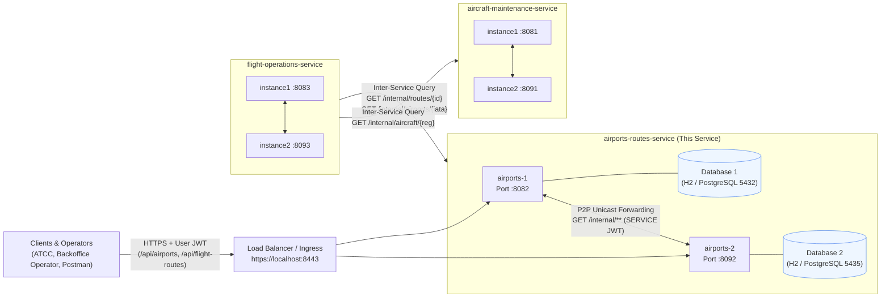
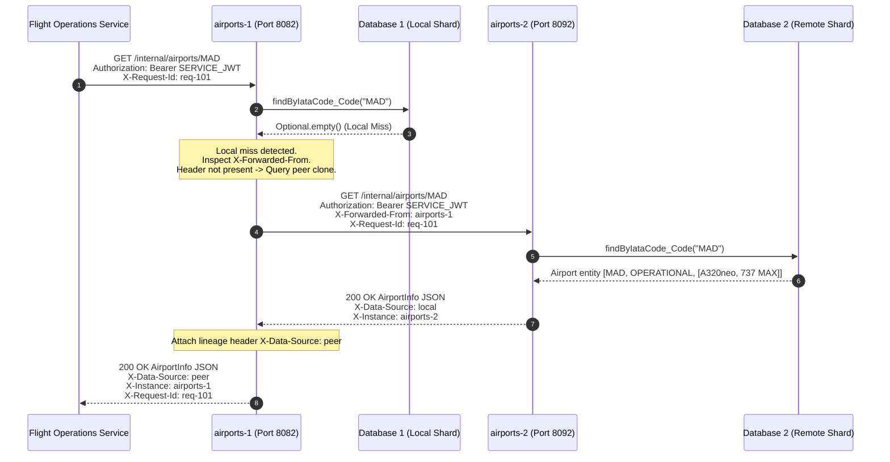
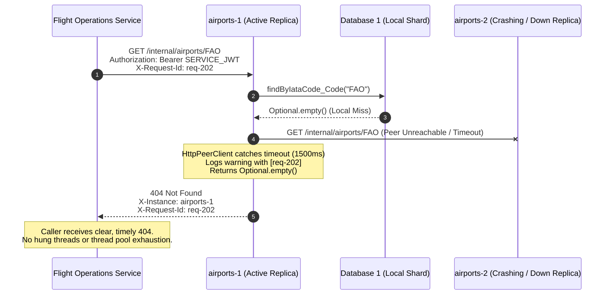
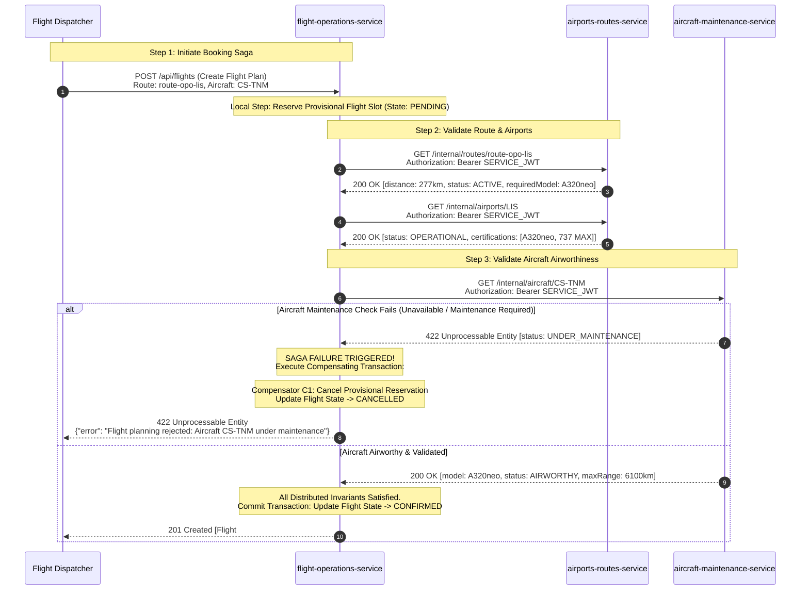
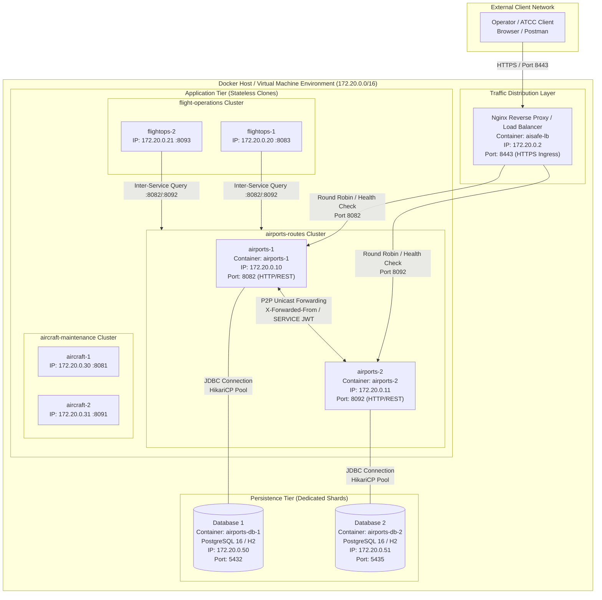
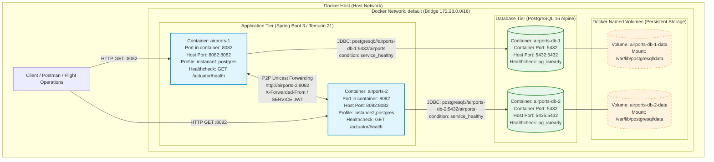

# Airports & Routes Service – Architecture & Distributed Design Document
**Course**: Sistemas Distribuídos (LETI-SIDIS 2026/2027) – ISEP  
**Professor**: Orlando Sousa  
**Student**: Afonso Sobreiro (1241013)  
**Assigned Service**: `airports-routes-service`  
**Transversal Responsibility**: Component Cloning, P2P Instance Replication & Unicast Query Forwarding  

---

## 1. Executive Summary & System Decomposition

The AISafe monolithic air traffic safety and flight scheduling system has been decomposed into three autonomous, domain-aligned microservices communicating exclusively over HTTP/REST:

1. **`aircraft-maintenance-service`** (André - 1240567): Manages aircraft models, physical aircraft fleet status, and maintenance logs. Port `:8081` (replica `:8091`).
2. **`airports-routes-service`** (Afonso - 1241013): Manages airport infrastructure, runways, aircraft model certifications, and flight route topologies. Port `:8082` (replica `:8092`).
3. **`flight-operations-service`** (José - 1240624): Coordinates flight planning, crew assignment, and flight dispatching via synchronous command orchestration. Port `:8083` (replica `:8093`).

Each service operates under the **Database-per-Service** pattern with independent schemas (H2 in development, PostgreSQL in staging/production), preventing database coupling and enforcing strict bounded contexts.

---

## 2. Architectural Drivers: FURPS+ & ISO/IEC 25010 Quality Model

The architecture addresses functional and non-functional requirements categorized under **FURPS+** and mapped to the **ISO/IEC 25010** software quality standard:

| Quality Category | ISO 25010 Characteristic | Architectural Implementation & Quality Driver |
| :--- | :--- | :--- |
| **Functionality (F)** | Functional Suitability | CRUD for airports and flight routes; validation of aircraft model certifications; distance and flight time calculations; internal query contract for flight planners. |
| **Reliability (R)** | Fault Tolerance & Recoverability | **Component Cloning**: Multi-instance active replication (`airports-1` on `:8082`, `airports-2` on `:8092`). **Unicast Forwarding**: Queries forward across peers on local misses. Loop prevention via `X-Forwarded-From` stops infinite cycles. Circuit breaking and connect/read timeouts (1500ms) prevent cascading failures. |
| **Performance (P)** | Performance Efficiency | Local-first retrieval with zero network hops when data resides on the queried replica; synchronous HTTP/REST with low latency (<50ms for local queries, <150ms for forwarded queries); connection pooling via HikariCP. |
| **Security (S+)** | Security & Confidentiality | Stateless JWT-based authentication. Strict separation of public API (`/api/**` requiring user roles such as `ATCC` or `BACKOFFICE_OPERATOR`) and private internal API (`/internal/**` requiring `SERVICE` role). Shared cluster secret prevents unauthorized access. |
| **Supportability (S+)** | Maintainability & Modularity | Spring Boot 3 modular design; Clean Architecture separating domain entities, services, and presentation; Docker readiness; automated MockMvc unit and integration tests. |
| **Observability (+)** | Analysability | Distributed correlation IDs (`X-Request-Id`) propagated across all inter-service and peer requests, populated into SLF4J MDC; instance identification via `X-Instance`; data source tracking via `X-Data-Source: local|peer`. |

---

## 3. Key Architectural Decisions (ADRs)

### ADR-1: Commands Only (No Asynchronous Events)
* **Context**: While modern microservices often leverage asynchronous event brokers (e.g., Apache Kafka, RabbitMQ), Assignment 1 guidelines explicitly restrict system communication.
* **Decision**: All inter-service and inter-instance communications rely **exclusively on synchronous HTTP/REST commands**. No event queues, message brokers, or transactional outboxes are utilized.
* **Consequence**: Data consistency and inter-service coordination must be handled synchronously through resilient HTTP queries and command compensations rather than eventual event streaming.

### ADR-2: Component Cloning & Data Partitioning
* **Context**: The service must support high availability and horizontal scaling without a shared database bottleneck.
* **Decision**: Deploy multiple autonomous clones (`airports-1`, `airports-2`) each with its own persistent store. A shard or partition may reside natively on one clone or both.
* **Consequence**: Clones must be capable of collaborating to resolve queries for resources stored on peer replicas.

### ADR-3: Unicast Peer Forwarding with Loop Prevention
* **Context**: A client or caller (e.g., Flight Operations) may query any available instance clone. If the queried clone experiences a local data miss, it must determine whether another clone holds the resource.
* **Decision**: The queried clone executes a **Unicast HTTP GET** to its configured peer list (`airports.peers`).
  * If found on a peer, the result is returned to the client with `X-Data-Source: peer`.
  * To prevent ping-pong cycles and infinite loops, any forwarded request includes the header `X-Forwarded-From: <selfName>`. If an instance receives a request containing `X-Forwarded-From`, it only queries its local database and never forwards further.
  * If both local and peer lookups miss, a definitive `404 Not Found` is returned.

### ADR-4: CAP Theorem & Consistency Model (AP Alignment)
* **Context**: Network partitions can isolate service instances.
* **Decision**: We align with **AP (Availability and Partition Tolerance)**. Airport catalogs and route topologies are read-dominated and have low volatility. Serving available catalog data even under network degradation is preferred over blocking air traffic control operations.

---

## 4. C4+1 Architectural Views

The system architecture is structured according to Philippe Kruchten's **4+1 View Model** (IEEE Software, 1995) adapted for distributed systems using the **C4 hierarchical abstraction**:

```
                  +-----------------------------------+
                  |         4+1 View Model            |
                  +-----------------------------------+
                                    |
          +-------------------------+-------------------------+
          |                         |                         |
   [Logical View]            [Process View]            [Deployment View]
   C4 Level 2 Container      Dynamic Scenarios (+1)     Physical/Virtual Nodes
   C4 Level 3 Component      Forwarding & Sagas         Ports & Network IPs
```

---

### 4.1. View 1: Logical View

#### 4.1.1. C4 Level 2: Container Diagram (System Distributed Topology)
Visualizes system actors, boundary protocols, the 3 microservices with their cloned instances, and dedicated database containers.



#### 4.1.2. C4 Level 3: Component Diagram (Inside an `airports-routes-service` Instance)
Details the internal building blocks of an instance, illustrating the security/tracing filter chain, controllers, domain services, persistence repositories, and peer client.


---

### 4.2. View 2: Process View (The "+1" Dynamic Distributed Scenarios)

The "+1" scenarios make runtime interactions, failure recovery, and distributed coordination explicit.

#### Scenario 2.1: Request Routing & Unicast Peer Forwarding with Failure Handling
When `flight-operations-service` queries `airports-1` for airport `MAD`, but `MAD` is stored on clone `airports-2`:



#### Scenario 2.2: Node Failure & Resilient Recovery (Timeout, Circuit Breaking)
When a peer clone crashes or becomes unreachable, the calling instance protects its own thread pool and gracefully terminates the query:



#### Scenario 2.3: Distributed Saga with Compensating Actions
Visualizes distributed transaction coordination across segregated services. When scheduling a flight, atomicity is maintained synchronously with compensating actions upon failure:



---

### 4.3. View 3: Deployment View (Physical/Virtual Nodes & Network Topology)

Shows the deployment architecture across container environments, detailing reverse proxy ingress, container IP assignments on Docker bridge `172.20.0.0/16`, listening ports, and dedicated database volumes:



#### 4.3.2. Standalone Docker Compose Deployment (`airports-routes-service`)

Details container orchestration, port bindings, named persistent volumes, and healthcheck dependencies within the service's own Docker environment:



---

### 4.4. View 4: Implementation View (Core Code Snippets)

Critical patterns implemented in `airports-routes-service`:

#### Loop Prevention & Peer Forwarding (`InternalAirportsRoutesController.java`)
```java
@GetMapping("/airports/{iata}")
public ResponseEntity<AirportInfo> getAirport(
        @PathVariable String iata,
        @RequestHeader(value = "X-Forwarded-From", required = false) String forwardedFrom,
        @RequestHeader(value = "X-Request-Id", required = false) String requestId,
        HttpServletResponse response) {

    Optional<Airport> optAirport = airportRepository.findByIataCode_Code(iata.toUpperCase());
    if (optAirport.isPresent()) {
        response.setHeader("X-Data-Source", "local");
        return ResponseEntity.ok(toAirportInfo(optAirport.get()));
    }

    // Loop Prevention: If already forwarded by a peer clone, do NOT forward again
    if (forwardedFrom != null && !forwardedFrom.isBlank()) {
        return ResponseEntity.notFound().build();
    }

    // Unicast Forwarding: Query peer replicas
    Optional<AirportInfo> fromPeer = peerClient.fetchAirportFromPeers(iata.toUpperCase(), requestId);
    if (fromPeer.isPresent()) {
        response.setHeader("X-Data-Source", "peer");
        return ResponseEntity.ok(fromPeer.get());
    }

    return ResponseEntity.notFound().build();
}
```

#### Distributed Correlation & Tracing (`RequestTracingFilter.java`)
```java
@Override
protected void doFilterInternal(HttpServletRequest request, HttpServletResponse response, FilterChain chain)
        throws ServletException, IOException {
    String requestId = request.getHeader("X-Request-Id");
    if (!StringUtils.hasText(requestId) || requestId.length() > 64) {
        requestId = UUID.randomUUID().toString().substring(0, 8);
    }
    MDC.put("requestId", requestId);
    MDC.put("instance", instanceName);
    response.setHeader("X-Request-Id", requestId);
    response.setHeader("X-Instance", instanceName);
    try {
        chain.doFilter(request, response);
    } finally {
        MDC.remove("requestId");
        MDC.remove("instance");
    }
}
```

---

## 5. Verification & Automated Test Coverage

The solution is verified by a suite of automated unit and integration tests:

| Test Case | Objective | Verification Method |
| :--- | :--- | :--- |
| `testLocalHitDoesNotForwardToPeer` | Ensure local data is served directly with zero inter-instance overhead. | MockMvc GET `/internal/airports/LIS`. Asserts status 200, header `X-Data-Source: local`, and `verify(peerClient, never())`. |
| `testLocalMissForwardsToPeerAndReturnsAggregatedResult` | Validate unicast forwarding across cloned components when data resides on peer. | MockMvc GET `/internal/airports/FAO` with mocked peer hit. Asserts status 200, header `X-Data-Source: peer`. |
| `testLoopPreventionWhenAlreadyForwarded` | Prove that circular query loops cannot occur in multi-instance topologies. | MockMvc GET with header `X-Forwarded-From: airports-2`. Asserts status 404 and `verify(peerClient, never())`. |
| `testLocalMissAndPeerMissReturnsNotFound` | Confirm definitive 404 when no clone in the cluster holds the resource. | MockMvc GET `/internal/airports/NONEXISTENT`. Asserts status 404 after single peer query. |
| `testRouteForwardingWhenMissingLocally` | Validate unicast forwarding for flight routes. | MockMvc GET `/internal/routes/route-opo-fao`. Asserts status 200, header `X-Data-Source: peer`. |
| `testInternalForbiddenForNonServiceUser` | Enforce inter-service security boundary. | MockMvc GET with user token lacking `ROLE_SERVICE`. Asserts status 403 Forbidden. |
| `testInternalAllowedForServiceUser` | Verify authorized service queries succeed. | MockMvc GET with `ROLE_SERVICE`. Asserts status 200 OK. |
